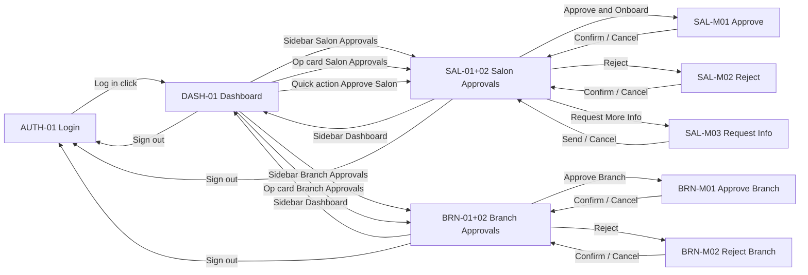

# GlowTap Super Admin — Figma Prototype Build Guide

**Figma file:** [UIUX](https://www.figma.com/design/ie2rXUSdWuGfBcvjyjGT0K/UIUX?node-id=0-1)  
**Wireframe source:** `wireframes/login.html`, `dashboard.html`, `salon-approvals.html`, `branch-approvals.html`  
**Screen inventory:** `Super-Admin-Figma-Screen-Guide.md` (~60 frames total)  
**Date:** June 2026

---

## 1. Can we build this in Figma?

**Yes — but not automatically from this repo.** You (or a designer) build frames in Figma using this guide. Two fast paths:

| Approach | Best for | Notes |
|----------|----------|--------|
| **A. Import HTML wireframes** | Speed on first 3 screens | Figma plugin **html.to.design** (or **Anima**) → open local `wireframes/*.html` → import → clean up auto-layout |
| **B. Build from spec** | Full ~60-frame system | Use tokens + components below; match `Super-Admin-Figma-Screen-Guide.md` IDs |

After frames exist, wire **Prototype** tab: clicks, overlays (modals), and **scroll** on main content (see **§5** — full step-by-step).

---

## 2. File structure in Figma

Create pages (tabs) in the UIUX file:

```
📁 Cover & Tokens
📁 Components
📁 Layout — SHELL-01
📁 Auth — AUTH-01
📁 Dashboard — DASH-01
📁 Salon Approvals — SAL-01, SAL-02, SAL-M01–M03
📁 Branch Approvals — BRN-01, BRN-02, BRN-M01–M02
📁 … (remaining categories from Figma Screen Guide)
📁 Prototype — optional duplicate linked frames for demo flow
```

**Frame naming:** `[ID] Screen Name` — e.g. `DASH-01 Dashboard Home`, `SAL-M01 Approve Lead Modal`.

**Desktop frame size:** `1440 × 1024` (min height; use **Vertical scrolling** on content — §5).

---

## 3. Design tokens (match wireframes)

Create **Color styles** and **Text styles** on the Cover page.

### Colors

| Token | Hex | Usage |
|-------|-----|--------|
| Purple / Primary | `#7B00FF` | CTAs, active nav, KPI accents |
| Purple Mid | `#9B2FD9` | Gradient mid |
| Pink Accent | `#FF03C8` | Badges, commission line |
| Text Primary | `#1E2A32` | Headings, values |
| Text Muted | `#6B7A88` | Labels, subtitles |
| Border | `#E2E8F0` | Cards, inputs |
| Background | `#F8F9FC` | Page bg |
| White | `#FFFFFF` | Cards, sidebar |
| Green | `#059669` | Positive trends, Paid |
| Amber | `#D97706` | Warnings, Pending |
| Red | `#DC2626` | Reject, errors |

**Gradient style:** `Brand Gradient` — linear 90°, `#7B00FF` → `#9B2FD9` → `#FF03C8`  
Use for: active nav item, primary buttons, logo text, progress bars.

**Shadow:** `0 4px 20px rgba(123,0,255,0.04)` on cards; `0 8px 24px rgba(123,0,255,0.28)` on primary buttons.

### Typography

| Style | Font | Size | Weight |
|-------|------|------|--------|
| Logo | Outfit | 20px | 700 |
| Page title | DM Sans | 24px | 700 |
| Section label | DM Sans | 13px | 700, uppercase, letter-spacing 0.06em |
| Body | DM Sans | 14px | 400–600 |
| Caption | DM Sans | 12px | 500 |
| KPI value | DM Sans | 24px | 700 |

Fonts: [DM Sans](https://fonts.google.com/specimen/DM+Sans), [Outfit](https://fonts.google.com/specimen/Outfit).

### Radius

- Buttons / pills: `999`
- Cards: `16`
- Inputs: `10–12`
- Icon containers: `12`

---

## 4. Components library (build once)

Create as **Components** with variants where noted.

### Layout

| Component | Size / notes |
|-----------|----------------|
| `SHELL-01 / Sidebar` | 280px wide, full height, white, border right |
| `SHELL-01 / Nav Item` | Variants: Default, Hover, **Active** (gradient fill, white text) |
| `SHELL-01 / Nav Badge` | Pink pill, white text |
| `SHELL-01 / Footer Link` | Notifications, Sign out |
| `SHELL-01 / User Card` | Avatar + name + email |

**Sidebar nav items (13):** Dashboard, Salon Approvals, Branch Approvals, All Salons, Transactions, Subscriptions, Reports, User Access, CMS & Banners, Analytics, Support, Master Config, Audit Log.

Icons: **Lucide** (same set as wireframes) — 18px stroke 2.

### UI primitives

| Component | Variants |
|-----------|----------|
| `Button / Primary` | Gradient, white text |
| `Button / Outline` | White, purple border |
| `Button / Danger` | White, red border |
| `Status Badge` | Pending Review, Awaiting Info, Approved, Rejected, Paid |
| `Card` | Default, with header slot |
| `Modal / Shell` | 480px wide, overlay 50% `#1E2A32` |
| `Input`, `Select`, `Date picker` | Match login + filter fields |
| `KPI Card` | Purple / pink / blue / green accent variants |
| `Operation Alert Card` | Icon + count + label |

---

**Desktop frame size:** `1440 × 1024` viewport; long content lives in a **taller inner frame** with **Vertical scrolling** on the wrapper (§5).

---

## 5. Scroll setup — step-by-step (do this after import)

Scrolling in Figma is **not** automatic from min-height. You need:

1. A **scroll wrapper** = viewport height (1024px)  
2. A **content child** = taller than the wrapper (e.g. 2800px)  
3. **Prototype → Overflow → Vertical scrolling** on the **wrapper** (not the child)  
4. Test in **Present** (▶) — scroll does not work like a browser in Design mode alone  

### 5.1 Layer tree — DASH-01 Dashboard Home

Name frames exactly so prototype links stay clear:

```
DASH-01 Dashboard Home          1440 × 1024   (screen frame — fixed size)
├── SHELL-01 / Sidebar          280 × 1024    (fixed — sibling of scroll area)
└── Main / Scroll               1160 × 1024   ← TURN ON VERTICAL SCROLL HERE
    └── Content / Dashboard     1160 × ~2800   ← must be TALLER than Main / Scroll
        ├── Page header
        ├── Operation Alerts
        ├── Key Metrics
        ├── Subscription Summary
        ├── Revenue & Commission
        ├── Platform Analytics
        ├── Performance & Insights
        └── Actions & Support
```

ASCII layout:

```
┌──────────────┬────────────────────────────────────┐
│   SIDEBAR    │  Main / Scroll  (1160 × 1024)      │
│   280px      │  ┌──────────────────────────────┐  │
│   FIXED      │  │ Content / Dashboard          │  │
│              │  │ (1160 × ~2800)               │  │
│              │  │  ↕ scrolls inside wrapper    │  │
│              │  └──────────────────────────────┘  │
└──────────────┴────────────────────────────────────┘
```

### 5.2 Build it in Figma (Dashboard)

**Step 1 — Screen frame**

1. Create frame **`DASH-01 Dashboard Home`**: **1440 × 1024**.  
2. Fill: `#F8F9FC`.  
3. Do **not** put vertical scroll on this outer frame (sidebar would scroll away).

**Step 2 — Sidebar (fixed)**

1. Place **`SHELL-01 / Sidebar`** instance at **x: 0, y: 0**, size **280 × 1024**.  
2. Keep it as a **direct child** of `DASH-01`, **not** inside `Main / Scroll`.

**Step 3 — Scroll wrapper**

1. Create frame **`Main / Scroll`** at **x: 280, y: 0**, size **1160 × 1024**.  
2. Clip content: **ON** (right panel → **Clip content** checked).  
3. This frame height = **viewport** — never set this to 2800px.

**Step 4 — Content (tall child)**

1. Inside `Main / Scroll`, create **`Content / Dashboard`**, width **1160**.  
2. Move **all** dashboard sections into this frame (header through Actions & Support).  
3. Select all sections → **Shift + A** (vertical Auto layout):  
   - Gap: **28**  
   - Padding: **28**  
   - Alignment: top-left  
4. With Auto layout, set `Content / Dashboard` height to **Hug contents**.  
5. Confirm **Content height > 1024** (typically **2400–3200px** after all sections).  
   - If height is still ~1024, sections are missing or sitting **outside** the content frame.

**Step 5 — Enable prototype scroll**

1. Select **`Main / Scroll`** (the 1024px wrapper, **not** Content).  
2. Open **Prototype** tab (right panel).  
3. **Overflow behavior** → **Vertical scrolling**.  
4. Optional: **Scroll behavior** → **Scroll with parent** (default is fine for this level).

**Step 6 — Test**

1. Click **Present** (▶) or **Prototype view**.  
2. Mouse wheel / trackpad over the main area — content should scroll; sidebar stays fixed.

### 5.3 Layer tree — SAL-01 Salon Approvals (master-detail)

```
SAL-01 Salon Approvals           1440 × 1024
├── SHELL-01 / Sidebar           280 × 1024
└── Main / Scroll                1160 × 1024   ← page-level scroll (optional)
    └── Content / Salon          1160 × ~1100
        ├── Page header
        ├── Filters card
        └── Split / MasterDetail 1160 × ~900
            ├── Lead list / Scroll    380 × 720   ← nested scroll
            │   └── Lead list content 380 × ~1200
            └── Review / Scroll         740 × 720   ← nested scroll
                └── Review body         740 × ~1100
```

**Nested scroll (lead list + review panel):**

1. **`Lead list / Scroll`**: fixed **380 × 720**.  
2. Inside it, **`Lead list content`**: **Hug** height with all lead rows (taller than 720).  
3. Select **`Lead list / Scroll`** → Prototype → **Vertical scrolling**.  
4. Repeat for **`Review / Scroll`** (740 × 720) if KYC + commission + buttons overflow.

Use nested scroll when the **page header + filters** should stay visible while only the list/review panes scroll.

### 5.4 Login — AUTH-01 (no scroll)

- Frame **1440 × 900** or **1440 × 1024**, centered card.  
- **No** vertical scroll unless you add a mobile variant.  
- Import via **`login.html?figma=1`** for fixed canvas (see `wireframes/FIGMA-IMPORT.md`).

### 5.5 Modals — SAL-M01, M02, M03 · BRN-M01, M02

1. Modal frame **480px** wide on **Overlay** interaction, or separate frame with dim `#1E2A32` at 50% opacity.  
2. If modal body is long: inner frame **Vertical scrolling** (wrapper 400px tall, content 600px+).  
3. Prototype: button → **Open overlay** → Close on **Navigate back** or backdrop tap.

**Branch modals (BRN-M01, BRN-M02):** Approve modal is for requests **within plan limit** only. At-limit requests show disabled Approve + informational branch limit check; Reject modal uses standard reason + notes (no plan upgrade controls).

### 5.6 After html.to.design import

HTML wireframes include **`?figma=1`** wrappers that map to Figma layers:

- Import **`dashboard.html?figma=1`**, **`salon-approvals.html?figma=1`**, and **`branch-approvals.html?figma=1`** (not plain URLs).
- Plugin should create **Sidebar** + **Main Scroll** + tall **Content** as nested frames.
- **You still set** Prototype → **Vertical scrolling** on **`Main Scroll`** once (html cannot set Figma prototype mode).
- If structure is wrong, search layers for `data-figma-layer` names or re-import with `?figma=1`.

### 5.7 Troubleshooting — content hidden / no scroll

| Problem | Fix |
|---------|-----|
| Bottom sections clipped, no scroll | Scroll is on wrong frame — move **Vertical scrolling** to **`Main / Scroll`**, not `DASH-01` or `Content` |
| Content same height as wrapper (~1024) | **`Content / Dashboard`** must **Hug** all sections and be **> 1024px** tall |
| Whole page scrolls including sidebar | Sidebar is **inside** scroll frame — move it out to be sibling of `Main / Scroll` |
| Min height on Content only | Min height does **not** create scroll — you still need wrapper + **Overflow: Vertical scrolling** |
| Works in Design, not in Present | Scroll only works in **Present / Prototype** mode |
| Auto layout height stuck | Ensure no section has **Fill container** vertically on the content frame |
| Imported frame one big 3000px block | Split: outer **1024** scroll wrapper + inner **Hug** content |

### 5.8 Reuse on every logged-in screen

For **BRN-01**, **ORG-01**, **TXN-01**, etc.:

1. Duplicate **`DASH-01`** structure (Sidebar + `Main / Scroll` + `Content / …`).  
2. Replace content inside `Content / …` only.  
3. Scroll settings copy with the `Main / Scroll` frame.

---

## 6. Prototype flow (wireframes built so far)

Use **Prototype** connections:



| From | Element | Interaction | To |
|------|---------|-------------|-----|
| AUTH-01 | Log in button | Navigate | DASH-01 |
| DASH-01 | Salon Approvals (nav) | Navigate | SAL-01+02 |
| DASH-01 | Salon Approvals op card | Navigate | SAL-01+02 |
| DASH-01 | Approve Salon quick action | Navigate | SAL-01+02 |
| SAL | Approve & Onboard | Open overlay | SAL-M01 |
| SAL | Reject | Open overlay | SAL-M02 |
| SAL | Request More Info | Open overlay | SAL-M03 |
| DASH-01 | Branch Approvals (nav) | Navigate | BRN-01+02 |
| DASH-01 | Branch Approvals op card | Navigate | BRN-01+02 |
| BRN | Approve Branch | Open overlay | BRN-M01 |
| BRN | Reject | Open overlay | BRN-M02 |
| BRN-M* | Cancel / backdrop | Close overlay | BRN |
| BRN-M01 | Confirm Approval | Close overlay + toast optional | BRN |
| BRN-M02 | Confirm Rejection | Close overlay | BRN |
| SAL-M* | Cancel / backdrop | Close overlay | SAL |
| SAL-M01 | Confirm Approval | Close overlay + toast optional | SAL |
| * | Sign out | Navigate | AUTH-01 |

**Animation:** Smart animate 200ms ease-out for modals; Instant for page nav (or Dissolve 150ms).

---

## 7. Screen-by-screen checklist (built wireframes)

### AUTH-01 Login ✅ wireframe

- [ ] Full-bleed background layers (photo blur, wave, glow orbs)
- [ ] White login card, torn edge decoration
- [ ] Email + password fields
- [ ] Gradient Log in button → prototype to DASH-01
- [ ] Social buttons (Google, Microsoft) — visual only unless in spec
- [ ] Forgot password link — disabled or note "out of scope v1.1"

### DASH-01 Dashboard Home ✅ wireframe

- [ ] SHELL-01 sidebar, Salon Approvals badge 12
- [ ] Page title + Export Report + Create Ticket
- [ ] Operation Alerts ×4 (Salon, Branch, Tickets, Defaulters)
- [ ] Key Metrics ×5
- [ ] Subscription Summary (MRR, ARR, renewals, plan distribution)
- [ ] Revenue & Commission chart (Monthly/Yearly tabs)
- [ ] Platform Analytics (DAU/MAU, churn, repeat) + System Alerts
- [ ] Performance: Top Salons, Top Cities, Most Booked Services
- [ ] Quick Actions + Recent Tickets
- [ ] **Vertical scroll** on main content

### SAL-01 + SAL-02 + modals ✅ wireframe

- [ ] Filters: status tabs + date + plan + city
- [ ] Lead list with status badges
- [ ] Review: business, subscription, KYC docs ×3
- [ ] Commission slider 1–25%
- [ ] Actions → three modals
- [ ] SAL-M01: confirm summary (plan, commission, branch, post-approval)
- [ ] SAL-M02: rejection reason dropdown + notes
- [ ] SAL-M03: document checklist + message

### BRN-01 + BRN-02 + modals ✅ wireframe

- [ ] Filters: status tabs (incl. Upgrade Required) + date + plan + salon
- [ ] Branch request list with branch count / limit badges
- [ ] Review: organization, requested branch, operating hours
- [ ] Branch limit check box + progress bar + at-limit info banner
- [ ] Actions → Approve (disabled at limit) + Reject
- [ ] BRN-M01: simple approval summary (within-limit case)
- [ ] BRN-M02: rejection reason + notes (no upgrade prompt controls)

---

## 8. Import wireframes into Figma (fastest start)

1. Install plugin **html.to.design** in Figma.
2. Run locally: `npx serve wireframes` → open `http://localhost:3000/login.html`.
3. Plugin → import URL or paste HTML file.
4. Repeat for `dashboard.html`, `salon-approvals.html`, `branch-approvals.html`.
5. Post-import cleanup:
   - Replace flat groups with **Auto layout**.
   - Swap colors for **Color styles** (§3).
   - Replace raster icons with **Lucide** components.
   - Split dashboard into scroll container + fixed sidebar.
   - Name frames with IDs (`DASH-01`, etc.).

Assets path: `wireframes/assets/` (`salon-bg.png`, `torn-white.png`, `torn-edge.png`, `wave-bg.webp`).

---

## 9. Remaining screens (from Figma Screen Guide)

After the first 4 wireframes, continue in this order (matches product priority):

1. All Salons — ORG-01, ORG-02 (+ 6 modals)  
2. Transactions — TXN-01, TXN-02  
3. Subscription Management — 5 pages  
4. Reports — 3 pages + modals  
5. User Access — 6 pages + modals  
6. CMS & Banners — 7 pages  
7. Platform Analytics — ANL-01  
8. Support — 2 pages + modal  
9. Master Configuration — 7 pages  
10. Audit Log — 1 page  

Build **SHELL-01** and **Components** first — every page uses them.

---

## 10. Prototype demo script (for stakeholders)

1. Start on **AUTH-01** → Log in  
2. **DASH-01** → scroll to show Subscription, Revenue chart, Analytics, Top Salons  
3. Click **Salon Approvals** → filter Pending → select lead  
4. Review KYC → adjust commission → **Approve** → confirm modal  
5. Optional: **Branch Approvals** → at-limit request (Approve disabled) → **Reject** with limit reason  
6. Return Dashboard → **Sign out**

Record with Figma **Present** mode or export prototype link.

---

## 11. What Cursor / AI cannot do

- Push frames directly into your Figma file without Figma API token + integration  
- Auto-generate all ~60 screens with working prototype in one step  

**What we can do in repo:** HTML wireframes (ongoing), this guide, mock data, and per-screen specs from `Super-Admin-Figma-Screen-Guide.md`.

---

*Next wireframe → Figma pair: All Salons (`ORG-01` / `ORG-02`). Say when to build the HTML wireframe.*
