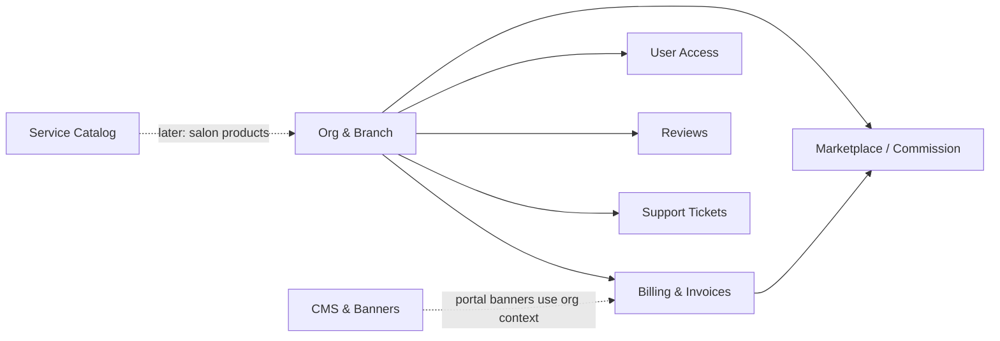
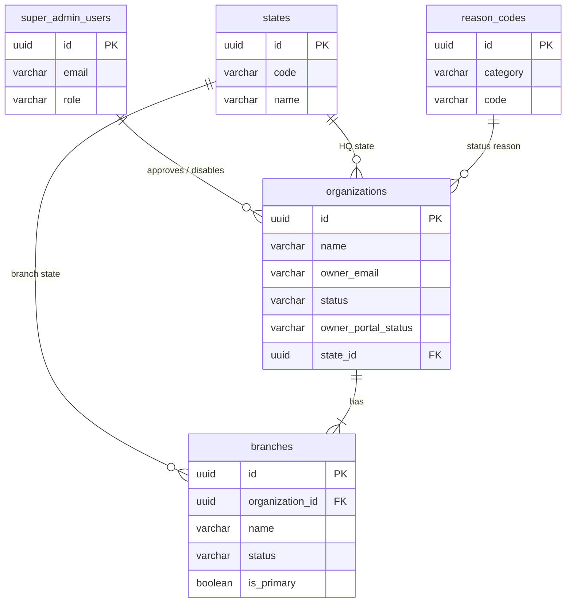
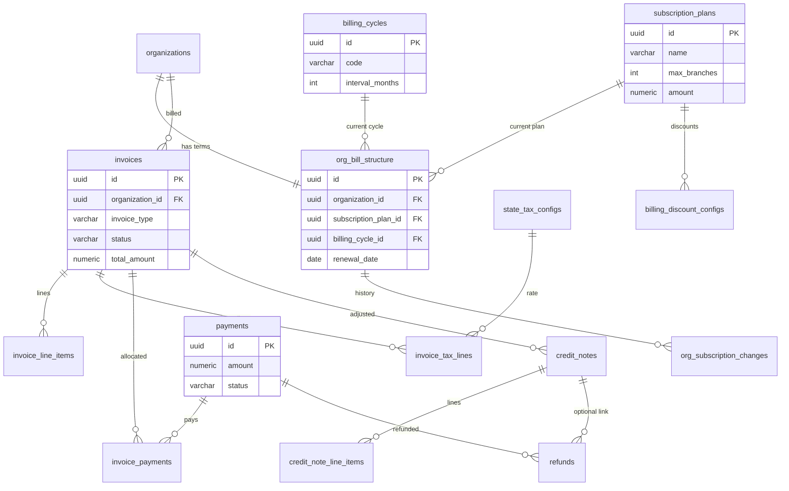
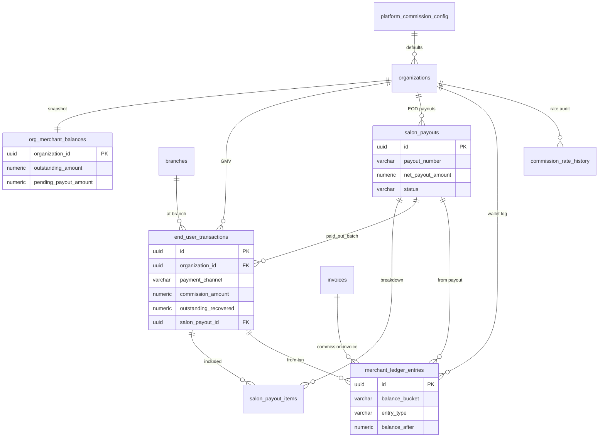
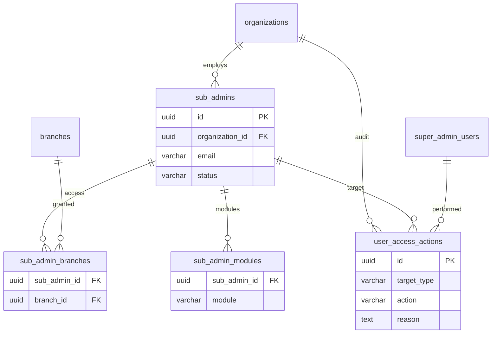
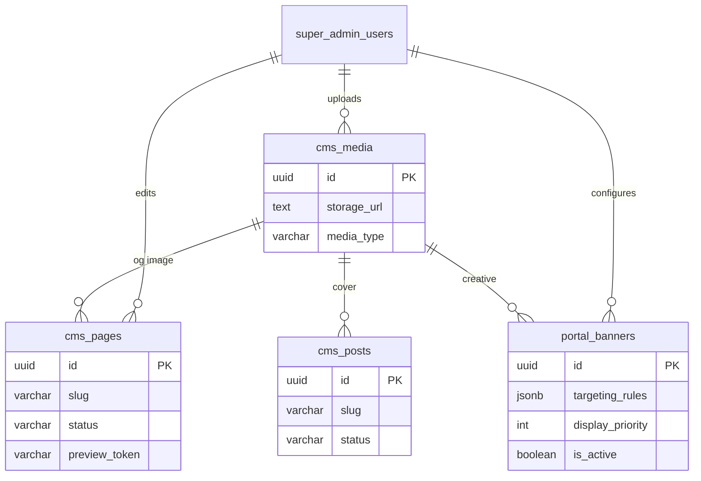
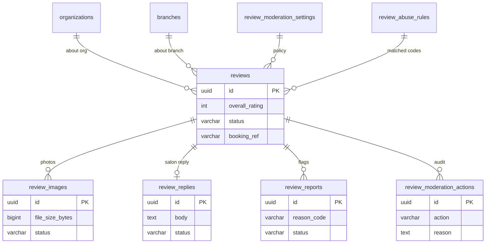
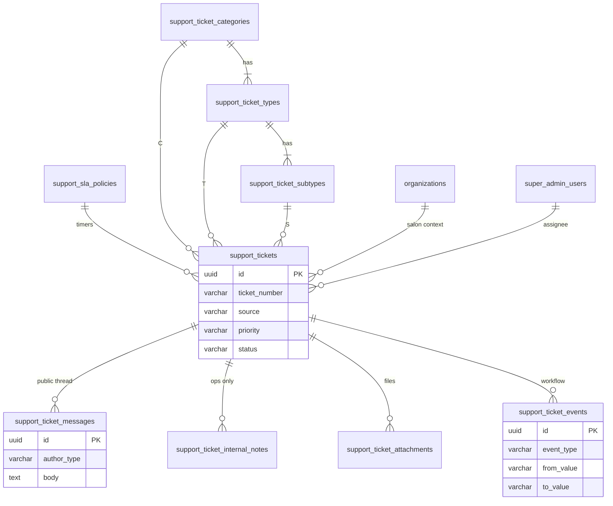
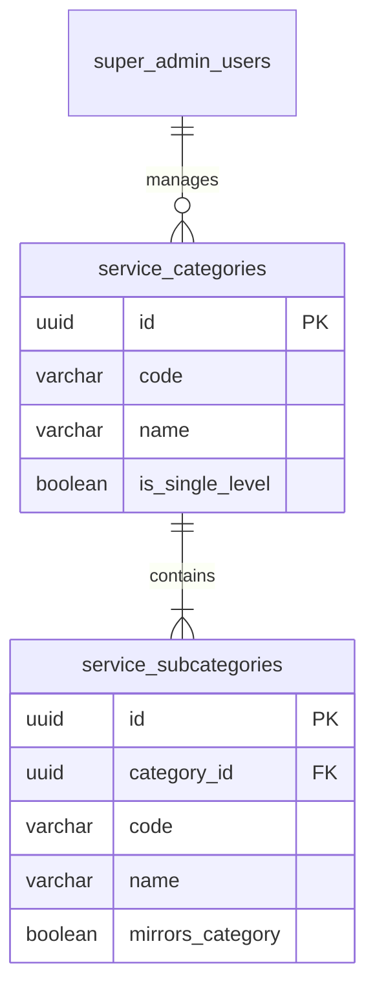
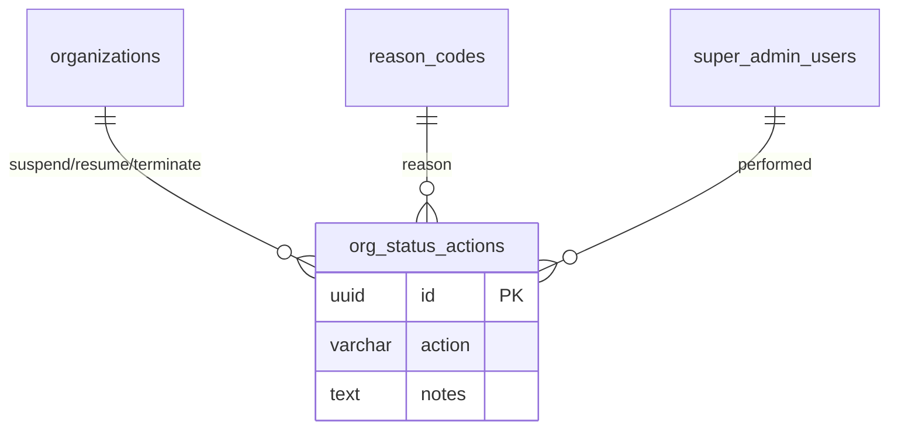

# GlowTap Super Admin — Database ER Guide

**Version:** 1.0  
**Date:** 29 Jul 2026  
**Audience:** Engineering / Product  
**Confidential**

---

## 1. Purpose

This document describes the **Neon Postgres** schema used by the GlowTap **Super Admin** platform: entities, relationships (ER), and how each domain works in practice.

The schema is organized into **domains**. Each section has:

1. A short explanation  
2. An **ER diagram** (Mermaid)  
3. Table roles  

> Soft references such as `booking_ref` / `end_user_ref` are intentional until Booking and End-User modules exist as first-class tables.

---

## 2. Domain map (high level)



| Domain | Tables (approx.) | Purpose |
|--------|------------------|---------|
| Core | organizations, branches, states, super_admin_users | Hierarchy & platform operators |
| Billing | plans, cycles, org_bill_structure, invoices, payments… | SaaS subscription money |
| Marketplace | end_user_transactions, ledger, payouts… | B2C GMV, commission, salon payout |
| Access | sub_admins, modules, branches access | Salon Admin / Sub Admin |
| CMS | cms_*, portal_banners | Website + salon portal promos |
| Reviews | reviews, moderation_* | Ratings moderation |
| Support | support_* | Tickets from salon + customer |
| Catalog | service_categories / subcategories | Platform taxonomy |

**53 tables · 132 foreign keys · 261 indexes** (as of migration 053).

---

## 3. Core — Organization & Branch

### Explanation

GlowTap is **Organization → Branch**.  
An **organization** is the salon business; a **branch** is a physical outlet. Super Admin users approve orgs/branches and manage platform config.

`organizations.owner_*` doubles as the **Salon Admin** profile (no separate main-admin table). Portal login gate uses `owner_portal_status`.

### ER diagram



### Table notes

| Table | Explanation |
|-------|-------------|
| `super_admin_users` | GlowTap ops accounts (SUPER_ADMIN, READ_ONLY, OPS_AGENT) |
| `states` | India state master for GST / tax |
| `organizations` | Salon business entity + owner (Salon Admin) fields |
| `branches` | Outlets; one primary per org; PENDING until approved |
| `reason_codes` | Suspend / Resume / Terminate reasons (org lifecycle) |

---

## 4. Billing & subscriptions

### Explanation

Catalog masters define **plans** and **billing cycles**. Each org has an **`org_bill_structure`** row (current commercial terms).  
**Invoices / payments / credit notes / refunds** are the money ledger for SaaS fees (and `COMMISSION` invoices for marketplace cash settlement).

### ER diagram



### Table notes

| Table | Explanation |
|-------|-------------|
| `subscription_plans` | Starter / Growth / Professional / Enterprise |
| `billing_cycles` | Monthly, Quarterly, Half-yearly, Yearly |
| `org_bill_structure` | Live commercial terms per org |
| `billing_discount_configs` | Plan × cycle discount rules |
| `org_subscription_changes` | Upgrade / downgrade audit |
| `state_tax_configs` | GST rates by state |
| `invoices` + lines + tax lines | Invoice documents |
| `payments` + `invoice_payments` | Cash in + allocation |
| `credit_notes` + lines + `refunds` | Adjustments / refunds |

---

## 5. Marketplace — B2C commission & payouts

### Explanation

Tracks **customer → salon** money flows:

- **Cash / pay-at-salon** → commission accrues to **outstanding**  
- **Online marketplace** → GlowTap collects; deducts commission, gateway fee, recovers outstanding; nets to salon via **payout**

Snapshot balances live on `org_merchant_balances`; history on `merchant_ledger_entries` (`OUTSTANDING` / `PAYABLE` buckets).

### ER diagram



### Table notes

| Table | Explanation |
|-------|-------------|
| `platform_commission_config` | Default %, invoice day, ₹5k threshold |
| `commission_rate_history` | Per-org rate changes |
| `end_user_transactions` | Each B2C booking payment |
| `org_merchant_balances` | Current outstanding + pending payout |
| `merchant_ledger_entries` | Append-only movements |
| `salon_payouts` / `salon_payout_items` | EOD transfer batch + lines |

**Outstanding** = salon owes GlowTap (cash commission).  
**Payable** = GlowTap owes salon (online net after recoveries).

---

## 6. User Access Control

### Explanation

- **Salon Admin** = org owner fields (`owner_*` + portal status)  
- **Sub Admins** = delegated users under an org with **branch** + **module** grants  
- Super Admin can disable; reasons go to `user_access_actions`

### ER diagram



### Modules (examples)

`BRANCH_PROFILE`, `EMPLOYEES`, `LEAVE_HOLIDAYS`, `ATTENDANCE`, `SERVICES`, `APPOINTMENTS`, `TRANSACTIONS`, `REPORTS`

---

## 7. CMS & Salon portal banners

### Explanation

**CMS** powers the public website (pages, blog, media).  
**Portal banners** are promotional cards inside the **Salon Admin** app. Targeting is JSONB evaluated at runtime against org plan / expiry / branch limits (not stored per org).

### ER diagram



### Notes

- Publish workflow: `DRAFT` → `SCHEDULED` → `PUBLISHED`  
- `preview_token` unlocks unpublished preview URLs  
- Banner rules example: `{ "all": [ { "field": "days_to_expiry", "op": "lte", "value": 30 } ] }`

---

## 8. Reviews & ratings moderation

### Explanation

Consumers submit reviews after completed bookings (soft `booking_ref`).  
Super Admin configures **settings** + **abuse rules** (no ML), then moderates via queue / reports. Audit actions include `AUTO_APPROVE` vs human `APPROVE`.

### ER diagram



### Status flow

`PENDING` (queued) → `PUBLISHED` | `HIDDEN` | `REJECTED`  
Public apps show only `PUBLISHED` (+ `ACTIVE` images).

---

## 9. Support & ticketing

### Explanation

SaaS helpdesk (Freshdesk-style). Tickets from **SALON** or **END_USER** (also SUPER_ADMIN / SYSTEM).  
**CTS** = Category → Type → Subtype (audience-filtered).  
**SLA** policies set first-response / resolve timers by priority.

### ER diagram



### Workflow

```
CREATED → IN_PROGRESS → ON_HOLD → AWAITING_USER → RESOLVED → CLOSED
                              ↑________________ REOPENED ______|
```

Messages support unlimited agent ↔ requester back-and-forth; events track status/assign history.

---

## 10. Service catalog taxonomy

### Explanation

Super Admin maintains a **2-level platform tree**: Category → Subcategory.  
Salon product names (e.g. “Baba Hair Cut”) come later under a subcategory.

**Single-level services:** category name = subcategory name, **different IDs** (`is_single_level` / `mirrors_category`).

### ER diagram



### Examples

| Category | Subcategories |
|----------|----------------|
| Hair Cut | Men's, Women's |
| Spa | Spa *(mirrored single-level)* |

---

## 11. Org lifecycle helpers



---

## 12. Cross-cutting conventions

| Convention | Detail |
|------------|--------|
| PKs | UUID `gen_random_uuid()` |
| Timestamps | `timestamptz` (`created_at` / `updated_at`) |
| Money | `numeric(12,2)`, currency INR |
| Soft refs | `booking_ref`, `end_user_ref`, `specialist_ref` until modules land |
| Audit reasons | Prefer action/log tables (`user_access_actions`, `review_moderation_actions`) over denormalized reason columns |
| Indexes | All FKs indexed (migration 040 + 053) |
| RLS | Neon Data API policies on application tables |

---

## 13. How to read these diagrams

In Mermaid ER notation (Crow’s foot style):

- **One-to-many (often mandatory children)** — double bar to crow’s foot: `one ||--|{ many`
- **One-to-many optional** — double bar to open crow’s foot: `one ||--o{ many`
- **One-to-one** — double bar both sides: `a ||--|| b`
- **One-to-zero-or-one** — double bar to open single: `a ||--o| b`

`||` = exactly one · `|` / `{` = many · `o` = optional (zero allowed)

---

## 14. Related artifacts

| Artifact | Path |
|----------|------|
| Drizzle schema | `SchemaMaking/superAdmin/db/schema.ts` |
| Migrations | `SchemaMaking/superAdmin/migrations/` |
| Org structure notes | `SchemaMaking/superAdmin/Solution docs/Organization-structure.md` |
| DB health PDF | `SchemaMaking/superAdmin/reports/GlowTap-SuperAdmin-DB-Health-Report.pdf` |

---

*Confidential — GlowTap Internal*
