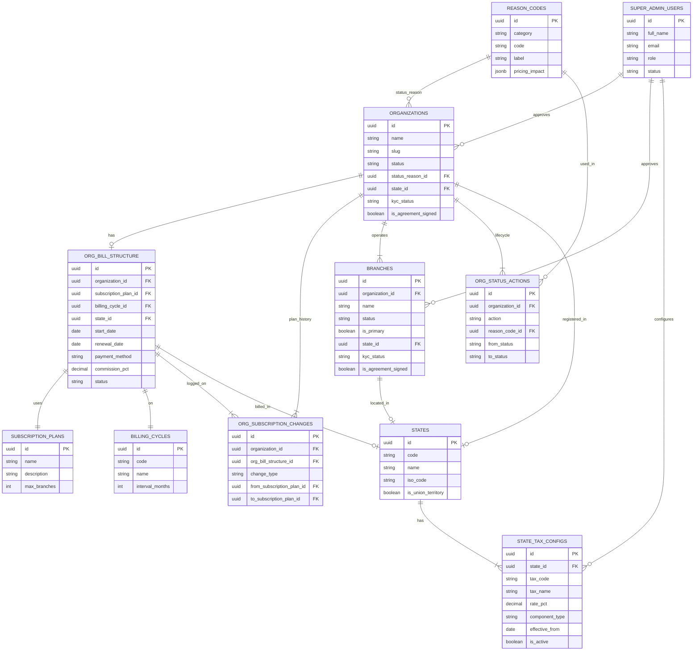

# GlowTap Super Admin — Organization Structure

**Version:** 1.5  
**Date:** July 14, 2026  
**Audience:** Product, engineering, operations  
**Purpose:** Define the core platform hierarchy — Super Admin, Organizations, Branches, and Subscription Plans — with compliance fields, document storage, reason codes for suspend/resume/terminate, and seeded dummy data.

---

## 1. Platform Hierarchy Overview

GlowTap is structured in three layers:

| Layer | Entity | Managed by |
|-------|--------|------------|
| Platform | **GlowTap** | Super Admin |
| Business | **Organization (Org)** | Salon owner at subscription signup |
| Location | **Branch** | Salon Admin per outlet |

A salon owner subscribes and creates one **Organization** (legal/business entity). Each org can operate **multiple branches** — separate physical salon locations under the same brand (e.g. Looks Salon & Spa with outlets in Andheri, Bandra, and Powai).

```
GlowTap Platform
└── Super Admin (1 platform operator)
    └── Organizations (onboarded salon businesses)
        └── Branches (physical salon locations)
```

**Key rule:** Branch creation is initiated by the **Salon Admin**, but every new branch stays in `PENDING` until the **Super Admin approves** it. Only `ACTIVE` branches appear to end users for booking.

---

## 2. Entity Relationship



---

## 3. Super Admin

There is **exactly one** Super Admin account in the current seed — the GlowTap platform operator who approves salons and branches.

### 3.1 Table: `super_admin_users`

| Column | Type | Description |
|--------|------|-------------|
| `id` | UUID | Primary key |
| `full_name` | VARCHAR | Display name |
| `email` | VARCHAR | Login email (unique) |
| `phone` | VARCHAR | Contact number |
| `role` | ENUM | `SUPER_ADMIN`, `READ_ONLY`, `OPS_AGENT` |
| `status` | ENUM | `ACTIVE`, `INACTIVE` |
| `mfa_enabled` | BOOLEAN | Multi-factor authentication flag |
| `last_login_at` | TIMESTAMPTZ | Last successful login |

### 3.2 Seeded Super Admin

| Field | Value |
|-------|-------|
| **Name** | Arjun Nair |
| **Email** | admin@glowtap.com |
| **Phone** | +91 98765 43210 |
| **Role** | SUPER_ADMIN |
| **ID** | `a1000000-0000-4000-8000-000000000001` |

---

## 4. Organization (Salon Business)

An **Organization** is the legal and commercial entity behind a salon brand. Think of **Looks Salon & Spa** as a brand — not a single shop, but the company that may own outlets in Andheri, Bandra, and Powai.

### 4.1 Lifecycle

```
Subscription signup → PENDING (Salon Approvals queue)
    → Super Admin approves → ACTIVE
    → Super Admin suspends (reason required) → SUSPENDED
    → Super Admin resumes (reason optional; note optional) → ACTIVE
    → Super Admin terminates (reason required) → TERMINATED
```

| Action | Org `status` | Reason required | Note |
|--------|--------------|-----------------|------|
| **Suspend** | `SUSPENDED` | Yes — `reason_codes` where `category = SUSPEND` | Show `pricing_impact` before confirm |
| **Resume** | `ACTIVE` | Optional — `category = RESUME` | Optional free-text note |
| **Terminate** | `TERMINATED` | Yes — `category = TERMINATE` | Show `pricing_impact` before confirm; no reactivation without re-onboarding |

Each action updates **organization** status fields and appends a row to **`org_status_actions`**.

On **first approval**, the primary branch is auto-activated. **Salon Admin** = org `owner_*` (credentials emailed to `owner_email`); no separate main-admin table.

### 4.2 Table: `organizations`

| Column | Type | Description |
|--------|------|-------------|
| `id` | UUID | Primary key |
| `name` | VARCHAR | Brand name shown in app (e.g. "Looks Salon & Spa") |
| `slug` | VARCHAR | URL-safe unique identifier |
| `legal_name` | VARCHAR | Registered company name for invoicing/KYC |
| `owner_name` | VARCHAR | Salon proprietor (**Salon Admin** display name) |
| `owner_email` | VARCHAR | Primary contact; Salon Admin login email |
| `owner_phone` | VARCHAR | Owner mobile |
| `owner_portal_status` | ENUM | `ACTIVE` / `DISABLED` — blocks Salon Admin login without deleting org |
| `owner_last_login_at` | TIMESTAMPTZ | Last Salon Admin portal login |
| `owner_disabled_at` / `owner_disabled_by` | | Quick disable flags; **reason** → `user_access_actions.reason` |
| `gst_number` | VARCHAR | GSTIN for Indian tax compliance |
| `pan_number` | VARCHAR | PAN for KYC |
| `logo_url` | TEXT | Brand logo (optional) |
| `kyc_document_url` | TEXT | S3 URL — owner ID / business KYC document |
| `gst_certificate_url` | TEXT | S3 URL — GST registration certificate |
| `photo_url` | TEXT | S3 URL — org cover / brand photo |
| `registered_address` | JSONB | HQ / registered office address (includes `city`, `pincode`, `country` in JSON) |
| `state_id` | UUID | FK → `states` (org registered / HQ GST state) |
| `campaign_attribution` | JSONB | Optional signup attribution (UTM / campaign params) |
| `business_type` | ENUM | `SOLE_PROPRIETOR`, `PARTNERSHIP`, `LLP`, `PRIVATE_LIMITED`, etc. |
| `cin` | VARCHAR | Company Identification Number (companies only) |
| `udyam_msme_number` | VARCHAR | MSME/Udyam registration |
| `gst_registration_type` | ENUM | `REGULAR`, `COMPOSITION`, `UNREGISTERED` |
| `kyc_status` | ENUM | `NOT_SUBMITTED`, `PENDING`, `VERIFIED`, `REJECTED` |
| `kyc_verified_at` | TIMESTAMPTZ | When KYC was verified |
| `kyc_verified_by` | UUID | FK → `super_admin_users` |
| `signed_agreement_url` | TEXT | S3 URL — signed GlowTap agreement |
| `is_agreement_signed` | BOOLEAN | Agreement signed flag |
| `status` | ENUM | `PENDING`, `ACTIVE`, `SUSPENDED`, `TERMINATED` |
| `status_reason_id` | UUID | FK → `reason_codes` — reason for current `SUSPENDED` / `TERMINATED` (or last resume reason) |
| `status_notes` | TEXT | Free-text note from the last status action |
| `status_changed_at` | TIMESTAMPTZ | When status last changed via suspend/resume/terminate |
| `status_changed_by` | UUID | FK → `super_admin_users` who performed the action |
| `suspended_at` | TIMESTAMPTZ | Last suspend timestamp |
| `resumed_at` | TIMESTAMPTZ | Last resume timestamp |
| `terminated_at` | TIMESTAMPTZ | Terminate timestamp (permanent) |
| `onboarded_at` | TIMESTAMPTZ | When org went live |
| `approved_at` | TIMESTAMPTZ | Super Admin approval timestamp |
| `approved_by` | UUID | FK → `super_admin_users` |

### 4.2a Reason codes & status actions

#### Table: `reason_codes`

Pre-configured master list used in Suspend / Resume / Terminate modals (Master Configuration).

| Column | Type | Description |
|--------|------|-------------|
| `id` | UUID | Primary key |
| `category` | ENUM | `SUSPEND`, `RESUME`, `TERMINATE` |
| `code` | VARCHAR | Stable machine code (unique per category) |
| `label` | VARCHAR | UI label |
| `description` | TEXT | Helper text shown in confirm modal |
| `pricing_impact` | JSONB | Optional fee / forfeiture shown before confirm |
| `is_active` | BOOLEAN | Soft-disable without deleting |
| `sort_order` | INT | Display order within category |

**`pricing_impact` shape (examples):**

```json
{ "type": "FIXED_FEE", "amount": 5000, "currency": "INR", "description": "Early termination fee" }
{ "type": "FORFEIT_DISCOUNT", "description": "Outstanding discounts forfeited" }
{ "type": "NONE" }
```

Suspend and terminate require a reason from this table. Resume may use a reason or only a note.

#### Table: `org_status_actions`

Append-only history of each org lifecycle action.

| Column | Type | Description |
|--------|------|-------------|
| `id` | UUID | Primary key |
| `organization_id` | UUID | FK → `organizations` |
| `action` | ENUM | `SUSPEND`, `RESUME`, `TERMINATE` |
| `from_status` | VARCHAR | Status before the action |
| `to_status` | VARCHAR | Status after the action |
| `reason_code_id` | UUID | FK → `reason_codes` (required for suspend/terminate); join for `pricing_impact` |
| `notes` | TEXT | Optional operator note |
| `performed_by` | UUID | FK → `super_admin_users` |
| `performed_at` | TIMESTAMPTZ | When the action ran |

### 4.3 Compliance & documents (organization)

Documents are stored in **AWS S3**; the database holds URL references only.

| Column | Document |
|--------|----------|
| `kyc_document_url` | Owner ID / business KYC (PDF) |
| `gst_certificate_url` | GST registration certificate |
| `photo_url` | Org cover / brand photo |
| `logo_url` | Brand logo (app listing) |
| `signed_agreement_url` | Signed GlowTap platform agreement |

| Column | Compliance field |
|--------|------------------|
| `business_type` | Legal entity: `SOLE_PROPRIETOR`, `PARTNERSHIP`, `LLP`, `PRIVATE_LIMITED`, `PUBLIC_LIMITED`, `OTHER` |
| `cin` | Company Identification Number (companies only) |
| `udyam_msme_number` | MSME/Udyam registration |
| `gst_registration_type` | `REGULAR`, `COMPOSITION`, `UNREGISTERED` |
| `kyc_status` | `NOT_SUBMITTED` → `PENDING` → `VERIFIED` or `REJECTED` |
| `kyc_verified_at` / `kyc_verified_by` | Super Admin verification audit |
| `is_agreement_signed` | `TRUE` when platform agreement is signed |

**KYC workflow (org):**

```
Signup uploads docs → kyc_status = PENDING
    → Super Admin reviews in Salon Approvals
    → VERIFIED (org can be approved) or REJECTED
```

### 4.4 Address JSON shape (`registered_address`)

```json
{
  "line1": "402, Oberoi Commerz II",
  "line2": "Goregaon East",
  "landmark": "Near Oberoi Mall",
  "city": "Mumbai",
  "state": "Maharashtra",
  "pincode": "400063",
  "country": "India"
}
```

---

## 5. Branch (Physical Salon Location)

A **Branch** is one bookable salon outlet under an organization — where customers discover services, check hours, and place bookings.

### 5.1 Lifecycle

```
Salon Admin submits branch → PENDING (Branch Approvals queue)
    → Super Admin approves → ACTIVE (visible to customers)
    → Super Admin rejects → REJECTED
    → Salon Admin deactivates → INACTIVE
```

**Plan limit check:** If `active_branch_count >= subscription_plans.max_branches` (via `org_bill_structure`), the request is flagged for upgrade before approval.

### 5.2 Table: `branches`

| Column | Type | Description |
|--------|------|-------------|
| `id` | UUID | Primary key |
| `organization_id` | UUID | FK → parent org |
| `name` | VARCHAR | Outlet name (e.g. "Looks — Andheri West") |
| `slug` | VARCHAR | Unique within org |
| `address` | JSONB | Full outlet address with landmark |
| `contact_phone` | VARCHAR | Branch reception number |
| `contact_email` | VARCHAR | Branch inbox |
| `operating_hours` | JSONB | Day-wise open/close or `closed` |
| `latitude`, `longitude` | DECIMAL | Map pin for discovery |
| `status` | ENUM | `PENDING`, `ACTIVE`, `INACTIVE`, `REJECTED` |
| `is_primary` | BOOLEAN | First branch created at org onboarding |
| `kyc_document_url` | TEXT | S3 URL — shop license / local KYC |
| `gst_certificate_url` | TEXT | S3 URL — branch GST certificate (if separate) |
| `photo_url` | TEXT | S3 URL — branch storefront photo |
| `state_id` | UUID | FK → `states` (GST state for branch location) |
| `shop_establishment_license_url` | TEXT | S3 URL — Shop & Establishment license |
| `shop_establishment_license_number` | VARCHAR | Shop & Establishment license number |
| `trade_license_url` | TEXT | S3 URL — municipal trade license |
| `trade_license_number` | VARCHAR | Municipal trade license number |
| `branch_gst_number` | VARCHAR | Separate GSTIN if branch differs from org |
| `kyc_status` | ENUM | `NOT_SUBMITTED`, `PENDING`, `VERIFIED`, `REJECTED` |
| `kyc_verified_at` | TIMESTAMPTZ | When branch KYC was verified |
| `kyc_verified_by` | UUID | FK → `super_admin_users` |
| `signed_agreement_url` | TEXT | S3 URL — signed branch agreement |
| `is_agreement_signed` | BOOLEAN | Agreement signed flag |
| `approved_at` | TIMESTAMPTZ | When branch went live |
| `approved_by` | UUID | FK → `super_admin_users` |

### 5.3 Compliance & documents (branch)

| Column | Document |
|--------|----------|
| `kyc_document_url` | Shop license / local KYC |
| `gst_certificate_url` | Branch GST certificate |
| `photo_url` | Storefront photo |
| `shop_establishment_license_url` | Shop & Establishment Act license (document) |
| `shop_establishment_license_number` | Shop & Establishment license number |
| `trade_license_url` | Municipal trade license (document) |
| `trade_license_number` | Municipal trade license number |
| `signed_agreement_url` | Signed branch-level agreement |

| Column | Compliance field |
|--------|------------------|
| `state_id` | FK → `states` — outlet GST jurisdiction (may differ from org HQ for multi-state chains) |
| `branch_gst_number` | Separate GSTIN if branch operates under different registration (nullable) |
| `kyc_status` | Same enum as org — verified before branch goes `ACTIVE` |
| `kyc_verified_at` / `kyc_verified_by` | Super Admin verification audit |
| `is_agreement_signed` | `TRUE` when branch agreement is signed |

**Note:** Org HQ state → `organizations.state_id`. Billing state → `org_bill_structure.state_id` (often same). Customer service GST → `branches.state_id`. They may differ for multi-state chains.

### 5.4 Primary branch (`is_primary`)

| Rule | Detail |
|------|--------|
| Set at onboarding | First branch submitted with org signup → `is_primary = TRUE` |
| Additional branches | Always `is_primary = FALSE` |
| Constraint | **One primary per org** — partial unique index `idx_one_primary_branch_per_org` |
| Purpose | Default Salon Admin context, signup anchor, reporting |

### 5.5 Operating hours JSON shape

```json
{
  "mon": { "open": "10:00", "close": "21:00" },
  "tue": { "open": "10:00", "close": "21:00" },
  "sun": { "closed": true }
}
```

---

## 6. States & Tax Configuration

Indian GST state codes are stored in a **`states`** master table. **`organizations`**, **`org_bill_structure`**, and **`branches`** reference states by **`state_id`** (UUID).

Super Admin configures per-state tax rates in **`state_tax_configs`** (e.g. CGST/SGST/IGST for salon services).

### 6.1 Table: `states`

| Column | Type | Description |
|--------|------|-------------|
| `id` | UUID | Primary key |
| `code` | VARCHAR(2) | GST state code (e.g. `27` = Maharashtra) |
| `name` | VARCHAR | State / UT name |
| `iso_code` | VARCHAR(3) | ISO 3166-2 code (e.g. `MH`) |
| `is_union_territory` | BOOLEAN | `TRUE` for UTs |
| `is_active` | BOOLEAN | Soft-disable without deleting |

Includes all **36 Indian states and UTs** (CBIC GST codes).

### 6.2 Table: `state_tax_configs`

| Column | Type | Description |
|--------|------|-------------|
| `id` | UUID | Primary key |
| `state_id` | UUID | FK → `states` |
| `tax_code` | VARCHAR | Admin-defined code (e.g. `CGST_SALON`, `SGST_SALON`, `IGST_SALON`) |
| `tax_name` | VARCHAR | Display label |
| `rate_pct` | DECIMAL(5,2) | Tax rate (e.g. `9.00` for 9% CGST) |
| `hsn_sac_code` | VARCHAR | SAC/HSN (e.g. `999714` for beauty services) |
| `component_type` | ENUM | `CGST`, `SGST`, `IGST`, `CESS`, `COMPOSITE` |
| `applies_to` | ENUM | `SERVICE`, `PRODUCT`, `BOTH` |
| `effective_from` | DATE | Rate effective start |
| `effective_to` | DATE | Optional end date |
| `is_active` | BOOLEAN | Toggle without deleting history |
| `created_by` / `updated_by` | UUID | FK → `super_admin_users` |

**Unique:** `(state_id, tax_code, effective_from)` — supports rate revisions over time.

### 6.3 Salon service rates (example)

For Delhi, Maharashtra, Karnataka, Tamil Nadu:

| tax_code | component | rate |
|----------|-----------|------|
| `CGST_SALON` | CGST | 9% |
| `SGST_SALON` | SGST | 9% |
| `IGST_SALON` | IGST | 18% |

Intra-state billing uses CGST + SGST; inter-state uses IGST.

---

## 7. Subscription Plans

### 6.1 Table: `subscription_plans`

| Column | Type | Description |
|--------|------|-------------|
| `id` | UUID | Primary key |
| `name` | VARCHAR | Plan display name (e.g. "Growth") |
| `description` | TEXT | Plan summary for Super Admin / signup UI |
| `max_branches` | INT | Branch cap (999 = unlimited) |
| `amount` | DECIMAL(12,2) | Catalog subscription price (INR, list price) |

### 6.2 Seeded plans

| Plan | Max branches | Amount (INR) | Example org |
|------|-------------|--------------|-------------|
| Starter | 1 | ₹999 | Enrich Salon |
| Growth | 3 | ₹2,499 | Looks Salon & Spa |
| Professional | 10 | ₹4,999 | Glamour Zone |
| Enterprise | 999 (unlimited) | ₹9,999 | Naturals Salon Partners |

Branch limits are read via join: `org_bill_structure.subscription_plan_id → subscription_plans.max_branches`.

---

## 7a. Billing Discount Configs

Super Admin configures discounts against a **plan**, a **billing cycle**, or **both**.  
**Unique rule:** each `(subscription_plan_id, billing_cycle_id)` pair can exist only once (including `NULL` = all plans / all cycles). Update the existing row to change a discount — do not insert a duplicate combo.

### Table: `billing_discount_configs`

| Column | Type | Description |
|--------|------|-------------|
| `id` | UUID | Primary key |
| `name` | VARCHAR | Admin label (e.g. "Yearly — 10% off") |
| `subscription_plan_id` | UUID | FK → `subscription_plans` (nullable = all plans) |
| `billing_cycle_id` | UUID | FK → `billing_cycles` (nullable = all cycles) |
| `discount_type` | ENUM | `PERCENTAGE` or `FIXED_AMOUNT` |
| `discount_value` | DECIMAL | % (1–100) or ₹ amount off |
| `priority` | INT | Display / evaluation order (default 100) |
| `is_stackable` | BOOLEAN | Reserved; with unique plan+cycle pairs, usually one rule applies |
| `is_active` | BOOLEAN | Soft toggle |
| `effective_from` / `effective_to` | DATE | Validity window |
| `notes` | TEXT | Internal notes |
| `created_by` / `updated_by` | UUID | FK → `super_admin_users` |

**Rule:** At least one of `subscription_plan_id` or `billing_cycle_id` must be set.

### Matching examples

| Config | Plan | Cycle | Type | Value |
|--------|------|-------|------|-------|
| Yearly — 10% off all plans | *(any)* | Yearly | PERCENTAGE | 10 |
| Half Yearly — 5% off | *(any)* | Half Yearly | PERCENTAGE | 5 |
| Growth Yearly — ₹500 off | Growth | Yearly | FIXED_AMOUNT | 500 |
| Enterprise Yearly — ₹1,000 off | Enterprise | Yearly | FIXED_AMOUNT | 1000 |

**Fee calculation (app logic):**

```
base = subscription_plans.amount  (or org platform_fee_amount override)
match = active discount where
  plan_id IS NULL OR plan_id = org.plan
  AND cycle_id IS NULL OR cycle_id = org.cycle
  AND today within effective_from..effective_to
prefer exact (plan + cycle) over (null plan + cycle) or (plan + null cycle)
final_fee = apply PERCENTAGE or FIXED_AMOUNT on base
```

---

## 8. Organization Billing (`org_bill_structure`)

Commercial terms — plan, billing cycle, payment method, and commission — live in **`org_bill_structure`**, not on `organizations`. One **active** row per org (enforced by partial unique index).

### 8.1 Table: `org_bill_structure`

| Column | Type | Description |
|--------|------|-------------|
| `id` | UUID | Primary key |
| `organization_id` | UUID | FK → `organizations` |
| `subscription_plan_id` | UUID | FK → `subscription_plans` |
| `billing_cycle_id` | UUID | FK → `billing_cycles` |
| `state_id` | UUID | FK → `states` — billing/GST jurisdiction for platform invoices |
| `start_date` | DATE | Contract / subscription start |
| `renewal_date` | DATE | Next renewal / billing date |
| `payment_method` | ENUM | `BANK_TRANSFER`, `UPI`, `CARD`, `NET_BANKING`, `NACH`, `CHEQUE`, `OTHER` |
| `commission_pct` | DECIMAL | GlowTap commission on end-user payments |
| `platform_fee_amount` | DECIMAL | Fixed platform subscription fee (INR) |
| `currency` | VARCHAR(3) | Default `INR` |
| `auto_renew` | BOOLEAN | Auto-renew on `renewal_date` |
| `grace_period_days` | INT | Days after renewal before suspension (default 7) |
| `free_usage_days` | INT | Total free-usage days granted so far (trial / complimentary; default 0) |
| `last_payment_at` | TIMESTAMPTZ | Last successful payment |
| `payment_reference` | VARCHAR | Bank/UPI/NACH reference |
| `status` | ENUM | `PENDING`, `ACTIVE`, `SUSPENDED`, `CANCELLED`, `EXPIRED` |
| `notes` | TEXT | Internal Super Admin notes |
| `configured_by` | UUID | FK → `super_admin_users` |

### 8.2 Subscription upgrade / downgrade history (`org_subscription_changes`)

Append-only audit log — same idea as `org_status_actions`. **Current** plan/cycle stay on `org_bill_structure`; each upgrade/downgrade also inserts a history row.

| Column | Type | Description |
|--------|------|-------------|
| `id` | UUID | Primary key |
| `organization_id` | UUID | FK → `organizations` |
| `org_bill_structure_id` | UUID | FK → `org_bill_structure` row that was updated |
| `change_type` | ENUM | `UPGRADE`, `DOWNGRADE` |
| `from_subscription_plan_id` | UUID | Plan before the change |
| `to_subscription_plan_id` | UUID | Plan after the change |
| `from_billing_cycle_id` | UUID | Cycle before (optional if unchanged) |
| `to_billing_cycle_id` | UUID | Cycle after |
| `effective_date` | DATE | When the plan change takes effect |
| `notes` | TEXT | Optional Super Admin / system note |
| `performed_by` | UUID | FK → `super_admin_users` |
| `performed_at` | TIMESTAMPTZ | When the change was recorded |

**Rule:** `from_subscription_plan_id` ≠ `to_subscription_plan_id`. Classify `UPGRADE` / `DOWNGRADE` by plan tier (e.g. `max_branches` or catalog `amount`).

**Seeded example:** Looks Salon & Spa — `Starter` → `Growth` (`UPGRADE`).

### 8.3 Seeded billing examples

| Organization | Plan | Cycle | Payment | Commission |
|--------------|------|-------|---------|------------|
| Looks Salon & Spa | Growth | Monthly | NACH | 8% |
| Glamour Zone | Professional | Quarterly | Bank transfer | 6% |
| Enrich Salon | Starter | Monthly | UPI | 5% |
| Naturals Salon Partners | Enterprise | Yearly | NACH | 4% |
| Blush & Bloom | Growth | Monthly | UPI | 7% |

### 8.4 Invoices, payments & credits (salon → GlowTap)

Aligned with **Stripe / Chargebee / Zoho Books** patterns: an **invoice** is the bill; **payments** are money attempts/receipts; **credit notes** + **refunds** reverse value. GST break-up is stored as **tax lines** (CGST/SGST or IGST).

```
org_bill_structure (current plan)
        │
        ▼
   invoices ──┬── invoice_line_items
              ├── invoice_tax_lines
              └── invoice_payments ──► payments ──► refunds
                        ▲
                   credit_notes ── credit_note_line_items
```

| Table | Role |
|-------|------|
| `invoices` | Subscription bill (purchase / renewal / upgrade / …) |
| `invoice_line_items` | Charge rows (plan, discount, proration, fee) |
| `invoice_tax_lines` | GST amounts on the line; rate/name/SAC via `state_tax_config_id` → `state_tax_configs`; invoice via `invoice_line_item_id` |
| `payments` | Gateway / manual collection attempt |
| `invoice_payments` | Amount applied from a payment to an invoice (partials OK) |
| `credit_notes` | Documented credit against an invoice |
| `credit_note_line_items` | Credit break-down |
| `refunds` | Money returned against a succeeded payment |

**Invoice status:** `DRAFT` → `OPEN` → `PAID` / `PARTIALLY_PAID` (or `VOID` / `UNCOLLECTIBLE`).

**Payment status:** `PENDING` → `PROCESSING` → `SUCCEEDED` / `FAILED` (retries = new `payments` rows on the same open invoice).

**Seeded example:** Looks Salon — `GT-INV-2026-00001` Renewal **PAID** ₹2,948.82 (Growth monthly + CGST/SGST 9%), payment `GT-PAY-2026-00001` via Razorpay NACH. Credits: `GT-CN-2026-00001` (`settlement_method = REFUND`, ₹500 + refund row); `GT-CN-2026-00002` (`APPLY_NEXT_INVOICE`, ₹236, no refund — open until next invoice). Commission settlement invoice: `GT-INV-2026-00002` (`invoice_type = COMMISSION`, OPEN ₹450 for July cash dues).

**Credit note settlement:** read `settlement_method` on `credit_notes` — do not infer only from joining `refunds`.

| `settlement_method` | Meaning |
|---------------------|---------|
| `REFUND` | Cash back; expect a `refunds` row with this `credit_note_id` |
| `APPLY_NEXT_INVOICE` | Balance carried to a later invoice; set `applied_to_invoice_id` + `settled_at` when used |
| `MANUAL` | Ops / offline settlement |

### 8.5 Marketplace B2C commissions & settlement (Uber-style)

End-user → salon money is **separate** from subscription billing, but **monthly cash-commission dues reuse** `invoices` / `payments` (`invoice_type = COMMISSION`).

```
ONLINE (MARKETPLACE):  Customer → GlowTap → (commission + fees + outstanding recovery) → Salon payout
CASH (MERCHANT):       Customer → Salon cash; GlowTap accrues OUTSTANDING commission
MONTHLY:               Remaining OUTSTANDING → invoices(COMMISSION) → salon pays via payments
```

| Table | Role |
|-------|------|
| `platform_commission_config` | Default %, min/max, monthly invoice day, due days, auto-recover, threshold |
| `commission_rate_history` | Audit of org commission % changes |
| `end_user_transactions` | Each B2C txn: gross, commission snapshot, gateway fee, net, channel, status |
| `org_merchant_balances` | Snapshot: `outstanding_amount`, `pending_payout_amount` |
| `merchant_ledger_entries` | Append-only wallet log (OUTSTANDING / PAYABLE buckets) |
| `salon_payouts` + `salon_payout_items` | GlowTap → salon transfer breakdown |
| `invoices` (`COMMISSION`) + `payments` | Monthly (or threshold) settlement of remaining cash commission |

**Also modeled (beyond the brief):** gateway fees, dispute/refund statuses on B2C txns, payout itemization, rate-change history, instant invoice threshold, booking/end-user refs (soft until those modules exist).

**EOD payout rule:** Online `SUCCESS` txns with `salon_payout_id IS NULL` are unpaid. Nightly job creates one `salon_payouts` per org → on `status = PAID`, set `salon_payout_id` on included txns. Paid check: join payout where `status = 'PAID'` (no separate flag).

**Seeded examples**
- Enrich (10%): cash ₹100 + ₹200 outstanding → online ₹2,000 recovers ₹300; payout `GT-PO-2026-00001` net ₹1,460
- Glamour (6.5%): open outstanding **₹325** (cash accruals only — not yet recovered/invoiced)
- Naturals (5%): cash ₹2,500 → online recovers ₹1,860 (payout ₹0); leftover outstanding **₹640**
- Looks (8%): cash/UPI-at-salon → `GT-INV-2026-00002` COMMISSION OPEN ₹450; online payout `GT-PO-2026-00002` net ₹1,800

---

## 9. Billing Cycles

Master lookup — referenced by `org_bill_structure.billing_cycle_id`.

### 9.1 Table: `billing_cycles`

| Column | Type | Description |
|--------|------|-------------|
| `id` | UUID | Primary key |
| `code` | VARCHAR | Machine key: `MONTHLY`, `QUARTERLY`, `HALF_YEARLY`, `YEARLY` |
| `name` | VARCHAR | Display name |
| `description` | TEXT | Summary for Super Admin UI |
| `interval_months` | INT | Billing interval in months (1, 3, 6, 12) |
| `is_active` | BOOLEAN | Soft-disable without deleting |

### 9.2 Seeded cycles

| Cycle | Code | Interval | Example org (seed) |
|-------|------|----------|-------------------|
| Monthly | `MONTHLY` | 1 month | Looks Salon & Spa, Blush & Bloom |
| Quarterly | `QUARTERLY` | 3 months | Glamour Zone |
| Half Yearly | `HALF_YEARLY` | 6 months | Enrich Salon |
| Yearly | `YEARLY` | 12 months | Naturals Salon Partners |

Assigned via `org_bill_structure.billing_cycle_id → billing_cycles.id`.

### 9.3 GST state codes (seeded)

| State | Code | Used by (seed) |
|-------|------|----------------|
| Maharashtra | `27` | Looks Salon & Spa, Blush & Bloom |
| Delhi | `07` | Glamour Zone |
| Karnataka | `29` | Enrich Salon |
| Tamil Nadu | `33` | Naturals Salon Partners |

---

## 10. Seeded Dummy Data Summary

### 7.1 Organizations (5 total)

| Org | City | Status | Plan | Branches | Commission |
|-----|------|--------|------|----------|------------|
| **Looks Salon & Spa** | Mumbai | ACTIVE | Growth | 3 (2 live, 1 pending) | 8.00% |
| **Glamour Zone** | New Delhi | **SUSPENDED** (non-payment) | Professional | 2 (1 live, 1 pending) | 6.50% |
| **Enrich Salon** | Bengaluru | ACTIVE | Starter | 1 (at plan limit) | 10.00% |
| **Naturals Salon Partners** | Chennai | ACTIVE | Enterprise | 4 (3 live, 1 pending) | 5.00% |
| **Blush & Bloom** | Pune | **PENDING** | Growth | 1 (awaiting org approval) | 5.00% |

### 7.2 Branch inventory (11 total)

| Branch | Org | City / Area | Status | Primary |
|--------|-----|-------------|--------|---------|
| Looks — Andheri West | Looks | Mumbai | ACTIVE | Yes |
| Looks — Bandra | Looks | Mumbai | ACTIVE | No |
| Looks — Powai | Looks | Mumbai | **PENDING** | No |
| Glamour Zone — Connaught Place | Glamour Zone | Delhi | ACTIVE | Yes |
| Glamour Zone — Saket | Glamour Zone | Delhi | **PENDING** | No |
| Enrich — Koramangala | Enrich | Bengaluru | ACTIVE | Yes |
| Naturals — T Nagar | Naturals | Chennai | ACTIVE | Yes |
| Naturals — Anna Nagar | Naturals | Chennai | ACTIVE | No |
| Naturals — Adyar | Naturals | Chennai | ACTIVE | No |
| Naturals — OMR Sholinganallur | Naturals | Chennai | **PENDING** | No |
| Blush & Bloom — Viman Nagar | Blush & Bloom | Pune | **PENDING** | Yes |

### 7.3 Compliance seed summary

| Org | Business type | GST type | State | KYC | Agreement |
|-----|---------------|----------|-------|-----|-----------|
| Looks Salon & Spa | PRIVATE_LIMITED | REGULAR | 27 | VERIFIED | Signed |
| Glamour Zone | LLP | REGULAR | 07 | VERIFIED | Signed |
| Enrich Salon | SOLE_PROPRIETOR | REGULAR | 29 | VERIFIED | Signed |
| Naturals Salon Partners | PRIVATE_LIMITED | REGULAR | 33 | VERIFIED | Signed |
| Blush & Bloom | SOLE_PROPRIETOR | UNREGISTERED | 27 | PENDING | Not signed |

Active branches: KYC `VERIFIED`, agreement signed, license URLs populated.  
Pending branches: KYC `PENDING`, agreement not signed.

### 7.4 Super Admin approval queues (demo state)

| Queue | Count | Examples |
|-------|-------|----------|
| **Salon Approvals** | 1 | Blush & Bloom (new subscription lead) |
| **Branch Approvals** | 3 | Looks Powai, Glamour Zone Saket, Naturals OMR |

---

## 11. S3 document path conventions (dummy seed)

Bucket: `glowtap-assets.s3.ap-southeast-1.amazonaws.com`

**Organization:**

```
/orgs/{org-slug}/kyc/owner-id.pdf
/orgs/{org-slug}/gst/gst-certificate.pdf
/orgs/{org-slug}/photos/org-cover.jpg
/orgs/{org-slug}/agreements/signed-agreement.pdf
```

**Branch:**

```
/orgs/{org-slug}/branches/{branch-slug}/kyc/shop-license.pdf
/orgs/{org-slug}/branches/{branch-slug}/gst/gst-certificate.pdf
/orgs/{org-slug}/branches/{branch-slug}/photos/storefront.jpg
/orgs/{org-slug}/branches/{branch-slug}/licenses/shop-establishment.pdf
/orgs/{org-slug}/branches/{branch-slug}/licenses/trade-license.pdf
/orgs/{org-slug}/branches/{branch-slug}/agreements/signed-agreement.pdf
```

---

## 12. Worked Example — Multi-Location Salon

**Organization:** *Looks Salon & Spa* represents the salon brand and business account.

**Branches** under that org are individual outlets end users can book:

- *Looks — Andheri West* — `ACTIVE`, bookable today (primary location)
- *Looks — Bandra* — `ACTIVE`, bookable today
- *Looks — Powai* — `PENDING`, submitted by Salon Admin, awaiting Super Admin approval (**not bookable yet**)

The Super Admin portal shows org-level metrics (total branches, commission %, plan) and drills into each branch with full address, hours, and approval status.

---

## 13. Database & tooling

| Item | Path / command |
|------|----------------|
| Neon database | `superAdmin` |
| SQL migrations | `SchemaMaking/superAdmin/migrations/` |
| Drizzle schema | `SchemaMaking/superAdmin/db/schema.ts` |
| Reference SQL | `SchemaMaking/superAdmin/db/*.reference.sql` |
| Connection | `SchemaMaking/superAdmin/connection.js` |
| Apply migrations | `npm run db:migrate` |
| Check DB state | `npm run db:status` |
| Browse data | `npm run db:studio` (Drizzle Studio) |

### Migration history

| File | Purpose |
|------|---------|
| `001_org_hierarchy.sql` | Core tables + indexes |
| `002_seed_dummy_data.sql` | Super Admin, plans, orgs, branches |
| `003_one_primary_branch_per_org.sql` | Unique primary branch per org |
| `004`–`006` | Removed `services_offered` column |
| `007_drop_seats_capacity.sql` | Removed `seats_capacity` |
| `008_subscription_plans.sql` | Plans table + `subscription_plan_id` FK |
| `009_kyc_gst_photo_urls.sql` | Document URL columns |
| `010_compliance_fields.sql` | KYC, agreements, licenses, business identity |
| `011_rename_branch_state_code.sql` | Renamed `state_code` → `branch_state_code` on branches |
| `012_data_api_grants_rls.sql` | Data API grants + RLS |
| `013_states_and_tax_config.sql` | `states`, `state_tax_configs`, `state_id` FKs |
| `014_branch_license_numbers.sql` | Shop & trade license numbers on branches |
| `015_billing_cycles.sql` | `billing_cycles` master + `billing_cycle_id` on orgs |
| `016_org_bill_structure.sql` | `org_bill_structure`; removed plan/cycle/commission from orgs |
| `017_org_bill_structure_state_id.sql` | `state_id` on `org_bill_structure` |
| `018_drop_org_state_id.sql` | Removed `state_id` from `organizations` |
| `019_org_bill_structure_free_usage_days.sql` | `free_usage_days` on `org_bill_structure` |
| `020_subscription_plan_amount.sql` | `amount` on `subscription_plans` |
| `021_billing_discount_configs.sql` | Plan/cycle discount rules (% or fixed amount) |
| `022_billing_discount_unique_plan_cycle.sql` | Unique `(plan_id, cycle_id)` on discount configs |
| `023_org_state_id.sql` | Replaced org `state` text with `state_id` FK |
| `024_drop_org_city_pincode.sql` | Dropped org `city` / `pincode` (use address JSON) |
| `025_drop_org_country.sql` | Dropped org `country` (use address JSON) |
| `026_org_campaign_attribution.sql` | `campaign_attribution` JSONB on organizations |
| `027_tax_codes_master.sql` | *(superseded)* introduced `tax_codes` |
| `028_tax_code_rate_pct.sql` | *(superseded)* rate on `tax_codes` |
| `029_revert_tax_codes_master.sql` | Restored tax fields on `state_tax_configs`; dropped `tax_codes` |
| `030_reorder_state_tax_configs_columns.sql` | Restored original column order on `state_tax_configs` |
| `031_reason_codes_org_status.sql` | `reason_codes`, org status action columns, `org_status_actions` |
| `032_seed_org_suspend_action.sql` | Demo: Glamour Zone suspended + `org_status_actions` row |
| `033_drop_org_status_actions_pricing_impact.sql` | Drop duplicate `pricing_impact` from log (use `reason_codes`) |
| `034_org_subscription_changes.sql` | Plan upgrade/downgrade history + Looks Salon seed row |
| `035_invoices_payments.sql` | Invoices, lines, GST tax lines, payments, allocations, credit notes, refunds + Looks seed |
| `036_invoice_tax_lines_use_config_fk.sql` | Tax lines use `state_tax_config_id` only (drop duplicated tax fields) |
| `037_dedupe_invoice_payment_fk_columns.sql` | Drop FK-duplicate columns on invoices / lines / credit notes / refunds |
| `038_seed_credit_note_refund.sql` | Demo credit note + refund on Looks Salon invoice/payment |
| `039_credit_note_settlement_method.sql` | `settlement_method` / apply-next-invoice fields + carry-forward seed |
| `040_performance_indexes.sql` | Hot FK/join indexes + `ANALYZE` for planner stats |
| `041_marketplace_commissions_settlement.sql` | B2C txns, ledger, payouts, commission config + mock data; `COMMISSION` invoices |
| `042_eut_is_paid_out.sql` | *(superseded)* added `is_paid_out` |
| `043_drop_eut_is_paid_out.sql` | Dropped redundant `is_paid_out` (use `salon_payout_id` + payout status) |
| `044_seed_outstanding_mocks.sql` | Open outstanding mocks: Glamour ₹325, Naturals ₹640 |
| `054_move_revenue_to_rms_schema.sql` | Move billing/invoices/payments/marketplace settlement tables into schema `rms` |
| `055_move_admin_access_to_admin_org.sql` | Move sub-admins + branch/module access + audit into schema `admin_org` |
| `056_move_cms_to_cms_schema.sql` | Move CMS media/pages/posts + portal banners into schema `cms` |
| `057_user_access_actions_to_public.sql` | Move `user_access_actions` back to `public` (shared audit) |
| `058_move_reviews_to_review_schema.sql` | Move reviews/images/replies + moderation into schema `review` |
| `059_move_support_to_tickets_schema.sql` | Move support tickets + CTS/SLA into schema `tickets` |
| `060_move_service_catalog_to_services_schema.sql` | Move service categories/subcategories into schema `services` |
| `061_subscription_schema_and_commission_to_public.sql` | `subscription_plans` + `org_subscription_changes` → `subscription`; `platform_commission_config` → `public` |
| `062_employee_management_schema.sql` | Employee schema — staff, weekly offs, leave, holidays, attendance |
| `063_branch_only_weekly_offs_and_holidays.sql` | Branch-only weekly offs (drop emp override); seed holidays for all branches |
| `064_no_default_sunday_weekly_off.sql` | No default Sunday off — admin must configure branch weekly offs |
| `065_branch_leave_policy_config.sql` | Branch leave year-end (Mar), carry-forward %, monthly accrual rules |
| `066_seed_branch_weekly_offs_demo.sql` | Seed demo Wednesday weekly off per branch (editable by admin) |
| `067_leave_type_carry_forward_flag.sql` | Per leave type carry_forward_allowed on branch accrual rules |
| `068_branch_leave_policies_have_leave_type.sql` | Policies per leave_type_id; year settings → branch_leave_year_configs |
| `069_leave_cf_on_policies_drop_year_config.sql` | CF %/max + year-end on policies; drop branch_leave_year_configs |
| `070_weekly_offs_on_branches_drop_table.sql` | Move weekly offs to `branches.weekly_off_days`; drop `employee.branch_weekly_offs` |
| `071_branch_services.sql` | Branch services (category/subcategory) + specialist tags |
| `072_branch_services_discount.sql` | Add discount_amount / discount_percent / discount_description |
| `073_appointments_schema.sql` | Appointments schema — holds, bookings, status/reschedule audit |
| `074_appointments_seed_fix.sql` | Idempotent demo seed (sample Classic Hair Cut bookings) |
| `075_drop_branch_slot_configs.sql` | Drop branch_slot_configs — slot length from branch_services.duration_minutes |
| Perf seed | `scripts/bulk-seed-perf.js` — interconnected PERF-* load (Neon 512 MB capped; use `--orgs=1000` after storage upgrade). Cleanup: `scripts/cleanup-perf-seed.js` |
| `046_drop_redundant_disabled_reason.sql` | Drop denormalized disable reasons (keep on `user_access_actions`) |
| `047_cms_and_portal_banners.sql` | CMS media/pages/posts + Salon Admin `portal_banners` |
| `048_review_moderation.sql` | Review moderation settings, abuse rules, reviews queue, reports, audit |
| `049_seed_review_moderation_actions.sql` | Sample AUTO_APPROVE + HIDE rows in `review_moderation_actions` |
| `050_review_action_auto_approve.sql` | Add `AUTO_APPROVE` action (system auto-publish vs human `APPROVE`) |
| `051_support_ticketing.sql` | Support CTS + SLA + tickets (salon & customer) |
| `052_service_catalog_taxonomy.sql` | Platform service Category → Subcategory masters |
| `053_performance_indexes_round2.sql` | Missing FK + hot-path indexes; ANALYZE all major tables |

---

## 14. User Access Control (§4.8)

### 14.1 Salon Admin (from organization)

No separate main-admin table. Super Admin lists Salon Admins from `organizations` (`owner_name`, `owner_email`, `owner_phone`) plus portal fields above. Branch access = **all branches** under the org.

| Super Admin action | How |
|--------------------|-----|
| View / edit contact | Update `owner_*` |
| Disable login | `owner_portal_status = DISABLED` + reason; log `user_access_actions` |
| Reset password | Auth service + `user_access_actions` (`RESET_PASSWORD`) |

### 14.2 Sub Admins

Created by Salon Admin (not Super Admin). Super Admin: **view + disable only**.

| Table | Purpose |
|-------|---------|
| `sub_admins` | Name, email, phone, status, disable flags (who/when), last login — **reason** on `user_access_actions` |
| `sub_admin_branches` | Assigned branches (same-org enforced by trigger) |
| `sub_admin_modules` | Module grants: `BRANCH_PROFILE`, `EMPLOYEES`, `LEAVE_HOLIDAYS`, `ATTENDANCE`, `SERVICES`, `APPOINTMENTS`, `TRANSACTIONS`, `REPORTS` |
| `user_access_actions` | Audit for disable / enable / reset / contact edits (**includes reason**) |

**Mocks:** Looks — Ananya (Andheri+Bandra), Rohan (Bandra only); Enrich — Sneha (active), Vikram (Super-Admin disabled).

---

## 15. CMS & Banner Management (§4.9)

### 15.1 Website CMS

| Table | Purpose |
|-------|---------|
| `cms_media` | S3 media library (images/videos) shared by pages, posts, banners |
| `cms_pages` | About / Pricing / Features / FAQ / Terms / Privacy (+ custom); SEO; `DRAFT` / `SCHEDULED` / `PUBLISHED` / `ARCHIVED` |
| `cms_posts` | Blog/news; tags; same publish workflow + `preview_token` |

Public site serves only `PUBLISHED` with `publish_at <= now()`. Preview uses `preview_token`.

### 15.2 Salon Admin portal banners

`portal_banners` — title, image, CTA, `targeting_rules` JSONB, `display_priority`, date range.

**Org context** (evaluated in API, not stored on banner): plan/cycle from `org_bill_structure`, `days_to_expiry`, `tenure_months`, `branch_limit_reached`, `org_status`.

**Rule example:**
```json
{"all":[
  {"field":"plan_id","op":"eq","value":"<professional-uuid>"},
  {"field":"days_to_expiry","op":"lte","value":30}
]}
```

**Mocks:** upgrade-from-monthly, renew-12M +1 month, switch-to-24M, branch-limit, feature announcement.

---

## 16. Reviews & Ratings Moderation (§4.14)

Super Admin moderation only (rule-based; no ML). Image standards: **max size / count / mime** — no width/height.

| Table | Purpose |
|-------|---------|
| `review_moderation_settings` | Platform defaults: max image MB, auto-publish, queue toggles |
| `review_abuse_rules` | Configurable regex/threshold rules → `QUEUE` / `AUTO_HIDE` / `REJECT_UPLOAD` |
| `reviews` | Consumer reviews; status `PENDING` / `PUBLISHED` / `HIDDEN` / `REJECTED` |
| `review_images` | Optional images (`file_size_bytes` only) |
| `review_replies` | Salon public reply; Super Admin can hide |
| `review_reports` | Flags from end user / salon / system |
| `review_moderation_actions` | Audit: `AUTO_APPROVE` / `APPROVE` / hide / reject / restore (**reason here**) |

`booking_ref` / `end_user_ref` soft until booking/end-user modules exist.

---

## 17. Support & Ticketing (§4.11)

SaaS-style helpdesk (Freshdesk/Zendesk pattern). **Two personas:** `SALON` + `END_USER` (also `SUPER_ADMIN` / `SYSTEM`).

### CTS (configurable)

| Level | Table | Notes |
|-------|--------|------|
| **C**ategory | `support_ticket_categories` | `audience` = `SALON` / `END_USER` / `BOTH` |
| **T**ype | `support_ticket_types` | Under category |
| **S**ubtype | `support_ticket_subtypes` | Under type; `default_priority` |

### Runtime

| Table | Purpose |
|-------|---------|
| `support_sla_policies` | First-response + resolve minutes per priority |
| `support_tickets` | Ticket header, CTS FKs, SLA due dates, CSAT |
| `support_ticket_messages` | Public conversation |
| `support_ticket_internal_notes` | Ops-only |
| `support_ticket_attachments` | Files |
| `support_ticket_events` | Status / assign audit |

**Mocks:** `GT-TKT-2026-00001` (Looks salon billing), `GT-TKT-2026-00002` (customer refund).

---

## 18. Service Catalog Taxonomy (§4.15)

Super Admin platform masters only (salon product names later).

| Table | Purpose |
|-------|---------|
| `service_categories` | Level 1 — e.g. Hair Cut, Spa |
| `service_subcategories` | Level 2 — e.g. Men's / Women's; or mirror of category name |

**Single-level rule:** `is_single_level = true` → one subcategory with same `name`, `mirrors_category = true`, **different `id`**.

**Later:** Salon Admin creates products under `(category_id, subcategory_id)` e.g. "Baba Hair Cut".

---

## 19. Next Steps (Future Docs)

This document covers **Phase 1 hierarchy + compliance documents**. Subsequent solution docs will add:

- `organization_subscriptions` (billing lifecycle / invoice history)
- `organization_bank_accounts` (payout settlement bank details)
- End-user accounts (replace soft `booking_ref` / `end_user_ref`); login history detail table
- Salon products / `branch_services` under `service_subcategories`
- DPDP consent & data deletion workflows
- REST API contracts for org/branch CRUD and approval workflows
- REJECT categories on `reason_codes` (lead reject — org lifecycle only; tickets use CTS)
- B2C refund/dispute workflows against `end_user_transactions`
- Banner rule evaluator service + Redis cache
- Rating-distribution analytics / `branch_rating_stats`
---

*Confidential — GlowTap Internal*
